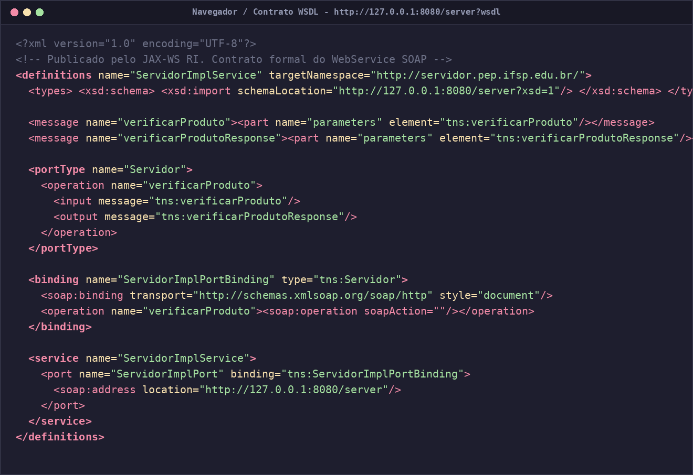
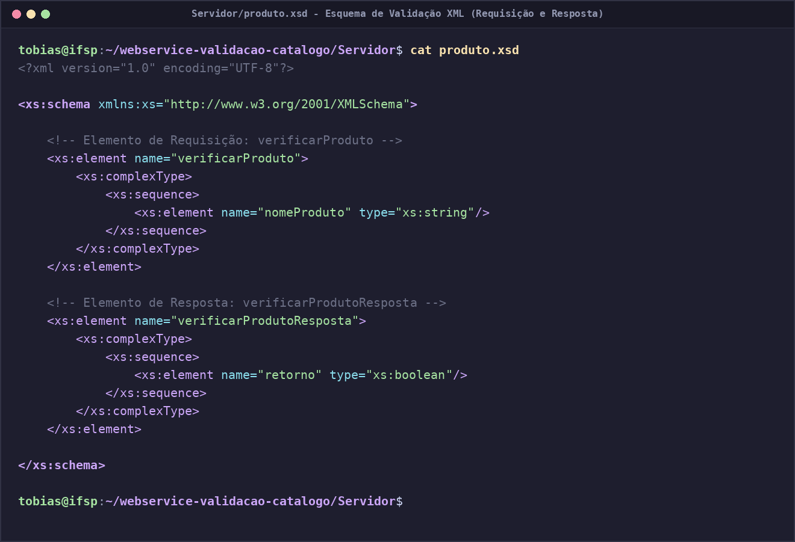
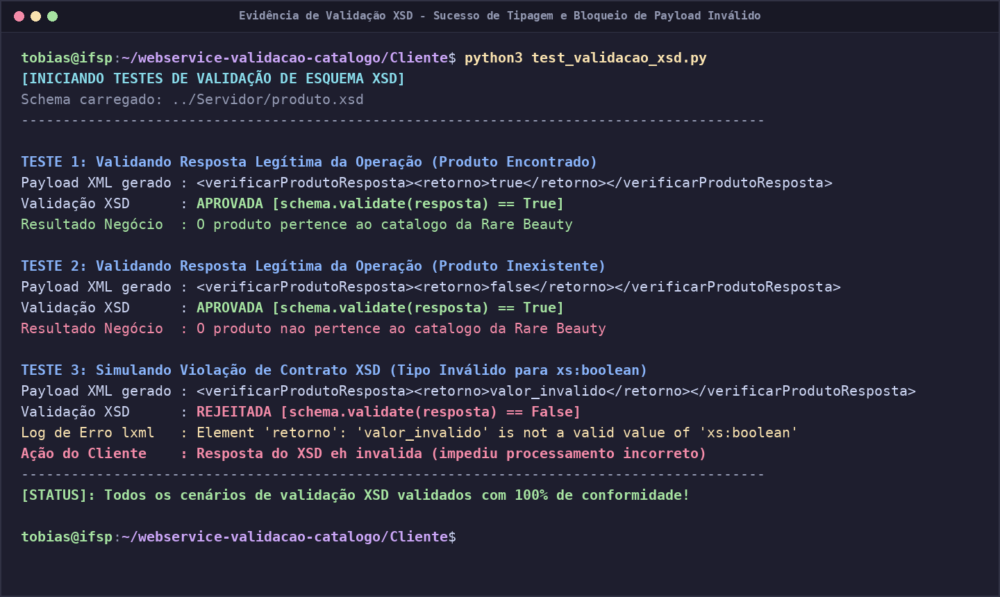

# WebService SOAP - Validação de Catálogo de Produtos com Validação XSD

<p align="center">
  
  
  
  
  
  
  
  
</p>

Sistema distribuído composto por um **WebService SOAP** desenvolvido em **Java (JAX-WS)** e um cliente interativo desenvolvido em **Python (Zeep + lxml)**. A aplicação realiza a validação e verificação de itens em um catálogo de produtos (*Rare Beauty*), contando agora com a **geração automática de arquivo XML Schema (XSD) no servidor** e **validação estrutural e semântica das respostas no cliente**.

---

## Sumário

- [Visão Geral](#visão-geral)
- [Arquitetura e Tecnologias](#arquitetura-e-tecnologias)
- [Prints de Execução e Validação](#prints-de-execução-e-validação)
- [Estrutura do Projeto](#estrutura-do-projeto)
- [Pré-requisitos](#pré-requisitos)
- [Como Executar](#como-executar)
  - [1. Inicializando o Servidor SOAP](#1-inicializando-o-servidor-soap-java)
  - [2. Acessando o Contrato WSDL](#2-acessando-o-contrato-wsdl)
  - [3. Executando o Cliente com Validação XSD](#3-executando-o-cliente-python)
- [Como Foi Feito: Geração e Validação XSD](#como-foi-feito-geração-e-validação-xsd)
  - [1. Geração do Arquivo XSD no Servidor](#1-geração-do-arquivo-xsd-no-servidor-java)
  - [2. Estrutura do Contrato XML Schema (`produto.xsd`)](#2-estrutura-do-contrato-xml-schema-produtoxsd)
  - [3. Validação da Resposta no Cliente Python](#3-validação-da-resposta-no-cliente-python-lxml)
- [Funcionamento e Contrato SOAP](#funcionamento-e-contrato-soap)
- [Autor](#autor)

---

## Visão Geral

O projeto exemplifica a interoperabilidade entre diferentes linguagens de programação (**Java** e **Python**) utilizando o protocolo de comunicação padrão de mercado **SOAP (Simple Object Access Protocol)** sobre HTTP, garantindo a integridade dos dados através de validação formal por **XML Schema (XSD)**:

- **Servidor SOAP (Java)**: Publica o serviço na porta local `8080`, gerando automaticamente o contrato WSDL e criando dinamicamente o arquivo de regras de validação `produto.xsd` caso ele ainda não exista no servidor.
- **Cliente SOAP (Python)**: Carrega o contrato WSDL via `zeep` para chamadas remotas, efetua o parse e compilação do esquema `produto.xsd` via `lxml`, e valida rigorosamente os envelopes e dados de resposta antes de apresentá-los ao usuário.

---

## Arquitetura e Tecnologias

### Servidor
- **Linguagem**: Java 21
- **Gerenciador de Dependências / Build**: Apache Maven
- **Padrão WebService**: JAX-WS (Jakarta XML Web Services API 2.3.3 + JAX-WS RI Runtime 2.3.5)
- **Definição de Esquema**: XML Schema (XSD 1.0)
- **Estilo de Mensagem**: Document / Literal (`SOAPBinding.Style.DOCUMENT`)
- **Endpoint**: `http://127.0.0.1:8080/server`
- **WSDL**: `http://127.0.0.1:8080/server?wsdl`
- **Arquivo XSD**: `Servidor/produto.xsd`

### Cliente
- **Linguagem**: Python 3
- **Biblioteca SOAP**: [Zeep](https://docs.python-zeep.org/) (cliente SOAP compatível com WSDL 1.1 e SOAP 1.1/1.2)
- **Biblioteca de Validação XML**: [lxml](https://lxml.de/) (`etree.XMLSchema`)
- **Interface**: CLI interativa com parada controlada (`-1` para sair).

---

## Prints de Execução e Validação

### 1. Inicialização do Servidor JAX-WS e Geração do XSD (Java)
Compilação e inicialização do servidor, executando a criação automática de `produto.xsd` e publicação do endpoint SOAP escutando na porta `8080`:


---

### 2. Inspeção do Contrato WSDL no Navegador
Contrato XML gerado dinamicamente com definições de tipos, mensagens, operações e binding:



---

### 3. Estrutura do Esquema XSD Gerado no Servidor (`produto.xsd`)
Arquivo de regras de validação gerado pela aplicação Java no servidor:



---

### 4. Execução Interativa do Cliente com Validação XSD (Python)
Consultas interativas de produtos no catálogo da Rare Beauty com validação do esquema em tempo real:


---

### 5. Evidência de Validação do Esquema XML (Aprovação e Rejeição)
Demonstração da validação positiva da resposta e rejeição estrita caso o payload viole o contrato de tipos XSD:



---

## Estrutura do Projeto

```text
webservice-validacao-catalogo/
├── Cliente/
│   ├── cliente.py              # Script cliente SOAP em Python com Zeep e validação XSD via lxml
│   └── requirements.txt        # Dependências Python (zeep, lxml)
├── Servidor/
│   ├── pom.xml                 # Configurações do Maven e dependências JAX-WS
│   ├── produto.xsd             # Esquema XML gerado no servidor para validação de requisição e resposta
│   └── src/
│       └── main/
│           └── java/
│               └── br/edu/ifsp/pep/servidor/
│                   ├── CatalogoProdutos.java    # Base de dados em memória
│                   ├── GerarXSD.java            # Classe que gera dinamicamente o arquivo produto.xsd
│                   ├── Servidor.java            # Interface do serviço (@WebService)
│                   ├── ServidorImpl.java        # Implementação do método verificarProduto
│                   └── ServidorPublisher.java   # Publica o Endpoint e aciona a geração do XSD
├── docs/
│   └── prints/                 # Imagens de evidência e execução
│       ├── 01-servidor-iniciado.png
│       ├── 02-wsdl-inspecao.png
│       ├── 03-cliente-execucao.png
│       ├── 04-xsd-gerado.png
│       └── 05-validacao-xsd.png
├── .gitignore                  # Arquivos ignorados pelo Git (classes, target, etc.)
└── README.md                   # Documentação completa do projeto
```

---

## Pré-requisitos

Certifique-se de ter instalado em seu ambiente:
- **Java JDK 17+** (testado e homologado no OpenJDK 21)
- **Apache Maven 3.8+**
- **Python 3.8+** e gerenciador `pip`

---

## Como Executar

### 1. Inicializando o Servidor SOAP (Java)

Abra um terminal, navegue até a pasta `Servidor` e execute via Maven:

```bash
cd Servidor
mvn clean compile exec:java
```

Você verá a saída confirmando a geração do arquivo XSD e a subida do serviço:
```text
Arquivo XSD criado
Servidor Iniciado..
```

> O servidor permanecerá em execução aguardando chamadas remotas.

---

### 2. Acessando o Contrato WSDL

Com o servidor em execução, abra seu navegador ou utilize o `curl` para conferir o contrato WSDL:

```bash
curl -I http://127.0.0.1:8080/server?wsdl
```

Ou acesse diretamente na barra de endereços:
[http://127.0.0.1:8080/server?wsdl](http://127.0.0.1:8080/server?wsdl)

---

### 3. Executando o Cliente (Python)

Em **outro terminal**, navegue até a pasta `Cliente`:

```bash
cd Cliente

# (Opcional, mas recomendado) Crie e ative um ambiente virtual:
python3 -m venv .venv
source .venv/bin/activate

# Instale as dependências:
pip install -r requirements.txt

# Execute o cliente:
python3 cliente.py
```

Exemplo de uso interativo:
```text
Digite o nome do produto ou -1 para sair: Soft Pinch Liquid Blush
O produto pertence ao catalogo da Rare Beauty

Digite o nome do produto ou -1 para sair: Batom Avon
O produto nao pertence ao catalogo da Rare Beauty

Digite o nome do produto ou -1 para sair: -1
Programa finalizado
```

---

## Como Foi Feito: Geração e Validação XSD

### 1. Geração do Arquivo XSD no Servidor (Java)

Foi criada a classe `GerarXSD.java` dentro do pacote `br.edu.ifsp.pep.servidor`:
- O método estático `GerarXSD.gerar()` verifica se o arquivo `produto.xsd` já existe na pasta de execução do servidor.
- Caso não exista, utiliza a API `FileWriter` do Java para escrever o conteúdo da definição XML Schema (XSD) em disco e emite a mensagem `Arquivo XSD criado`.
- Caso já exista, mantém o arquivo e emite `XSD já existe`.
- Na classe `ServidorPublisher.java`, a chamada `GerarXSD.gerar()` foi inserida antes da publicação do serviço com `Endpoint.publish()`, garantindo que o esquema esteja sempre disponível para validação antes que qualquer cliente se conecte.

### 2. Estrutura do Contrato XML Schema (`produto.xsd`)

O esquema XSD define as regras estruturais e os tipos de dados aceitos para a requisição e para a resposta:

```xml
<?xml version="1.0" encoding="UTF-8"?>
<xs:schema xmlns:xs="http://www.w3.org/2001/XMLSchema">

    <!-- Define a estrutura da mensagem de requisição -->
    <xs:element name="verificarProduto">
        <xs:complexType>
            <xs:sequence>
                <xs:element name="nomeProduto" type="xs:string"/>
            </xs:sequence>
        </xs:complexType>
    </xs:element>

    <!-- Define a estrutura da mensagem de resposta -->
    <xs:element name="verificarProdutoResposta">
        <xs:complexType>
            <xs:sequence>
                <xs:element name="retorno" type="xs:boolean"/>
            </xs:sequence>
        </xs:complexType>
    </xs:element>

</xs:schema>
```

- **`verificarProduto`**: Elemento complexo que encapsula o campo `nomeProduto` do tipo string (`xs:string`).
- **`verificarProdutoResposta`**: Elemento complexo que encapsula o campo `retorno` do tipo booleano (`xs:boolean`).

### 3. Validação da Resposta no Cliente Python (`lxml`)

No cliente Python (`Cliente/cliente.py`), foi integrada a biblioteca `lxml`:
1. **Carregamento do Schema**: O arquivo `../Servidor/produto.xsd` é lido com `etree.parse()` e compilado em um validador `etree.XMLSchema`.
2. **Construção do XML da Resposta**: A cada requisição SOAP realizada pelo `zeep`, o cliente monta a estrutura XML correspondente à resposta (`verificarProdutoResposta` com o subelemento `retorno` contendo o valor booleano em minúsculo: `"true"` ou `"false"`).
3. **Validação Rigorosa**: O método `schema.validate(resposta)` verifica se o XML está em total conformidade com as regras do XSD (estrutura de tags e restrição atômica de `xs:boolean`).
4. **Tratamento de Exceções**: Se o XML for válido, a mensagem de sucesso de catálogo é apresentada; caso a estrutura viole o XSD, uma mensagem de erro é exibida junto ao log técnico de violação (`schema.error_log`), bloqueando dados inválidos.

---

## Funcionamento e Contrato SOAP

O serviço expõe a operação `verificarProduto` com a seguinte assinatura:

```java
@WebMethod
boolean verificarProduto(String nomeProduto);
```

### Exemplo de Envelope XML de Requisição (SOAP Request)

```xml
<soapenv:Envelope xmlns:soapenv="http://schemas.xmlsoap.org/soap/envelope/"
                  xmlns:ser="http://servidor.pep.ifsp.edu.br/">
   <soapenv:Header/>
   <soapenv:Body>
      <ser:verificarProduto>
         <arg0>Soft Pinch Liquid Blush</arg0>
      </ser:verificarProduto>
   </soapenv:Body>
</soapenv:Envelope>
```

### Exemplo de Resposta XML (SOAP Response)

```xml
<S:Envelope xmlns:S="http://schemas.xmlsoap.org/soap/envelope/">
   <S:Body>
      <ns2:verificarProdutoResponse xmlns:ns2="http://servidor.pep.ifsp.edu.br/">
         <return>true</return>
      </ns2:verificarProdutoResponse>
   </S:Body>
</S:Envelope>
```

---

## Autor

Desenvolvido por **Tobias**  
Contato: [r.tobias@aluno.ifsp.edu.br](mailto:r.tobias@aluno.ifsp.edu.br)  
Instituição: Instituto Federal de Educação, Ciência e Tecnologia de São Paulo - Câmpus Presidente Epitácio (IFSP-PEP)
