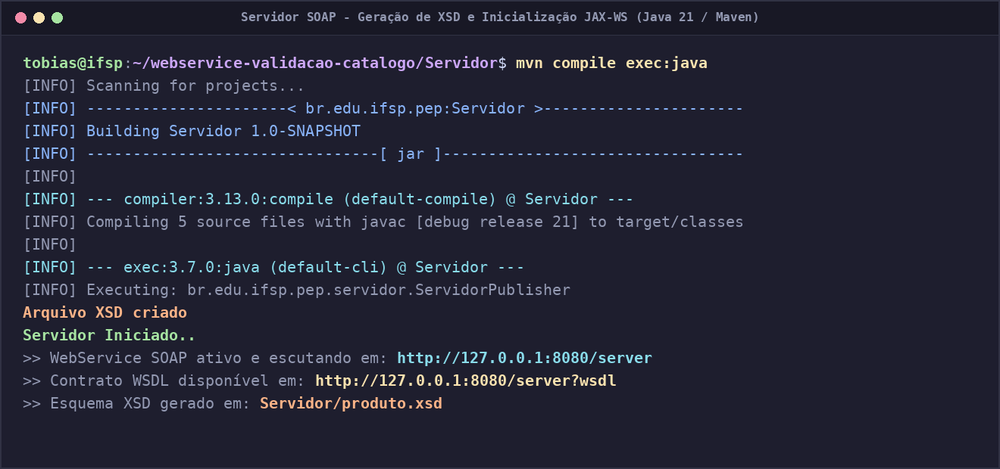
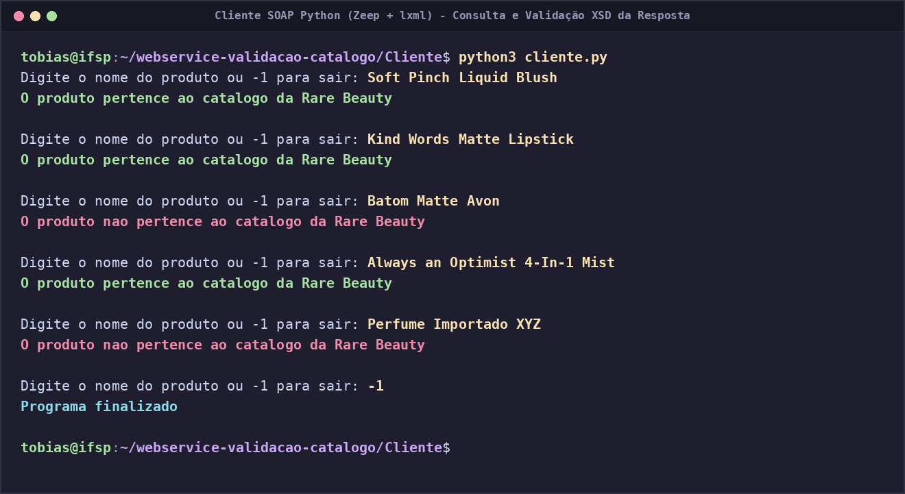

# WebService SOAP - Validação de Catálogo de Produtos

<p align="center">
  
  
  
  
  
  
</p>

Sistema distribuído composto por um **WebService SOAP** desenvolvido em **Java (JAX-WS)** e um cliente interativo desenvolvido em **Python (Zeep)**, permitindo a validação remota e verificação de disponibilidade de itens em um catálogo de produtos cosméticos (*Rare Beauty*).

---

## Sumário

- [Visão Geral](#visão-geral)
- [Arquitetura e Tecnologias](#arquitetura-e-tecnologias)
- [Prints de Execução](#prints-de-execução)
- [Estrutura do Projeto](#estrutura-do-projeto)
- [Pré-requisitos](#pré-requisitos)
- [Como Executar](#como-executar)
  - [1. Inicializando o Servidor SOAP](#1-inicializando-o-servidor-soap-java)
  - [2. Acessando o Contrato WSDL](#2-acessando-o-contrato-wsdl)
  - [3. Executando o Cliente](#3-executando-o-cliente-python)
- [Funcionamento e Contrato SOAP](#funcionamento-e-contrato-soap)
- [Autor](#autor)

---

## Visão Geral

O projeto exemplifica a interoperabilidade entre diferentes linguagens de programação (**Java** e **Python**) utilizando o protocolo de comunicação padrão de mercado **SOAP (Simple Object Access Protocol)** sobre HTTP.

- **Servidor SOAP (Java)**: Publica um serviço na porta local `8080`, gerando automaticamente o contrato WSDL (*Web Services Description Language*). Implementa a lógica de negócio para busca e verificação de itens em uma base de dados em memória.
- **Cliente SOAP (Python)**: Lê dinamicamente o WSDL em tempo de execução via biblioteca `zeep`, constrói os envelopes XML de requisição e exibe o resultado formatado no terminal para o usuário.

---

## Arquitetura e Tecnologias

### Servidor
- **Linguagem**: Java 21
- **Gerenciador de Dependências / Build**: Apache Maven
- **Padrão WebService**: JAX-WS (Jakarta XML Web Services API 2.3.3 + JAX-WS RI Runtime 2.3.5)
- **Estilo de Mensagem**: Document / Literal (`SOAPBinding.Style.DOCUMENT`)
- **Endpoint**: `http://127.0.0.1:8080/server`
- **WSDL**: `http://127.0.0.1:8080/server?wsdl`

### Cliente
- **Linguagem**: Python 3
- **Biblioteca SOAP**: [Zeep](https://docs.python-zeep.org/) (cliente SOAP rápido e compatível com especificações WSDL 1.1 e SOAP 1.1/1.2)
- **Interface**: CLI interativa com parada controlada (`-1` para sair).

---

## Prints de Execução

### 1. Inicialização do Servidor JAX-WS (Java)
Compilação e inicialização do endpoint SOAP escutando requisições na porta `8080`:



---

### 2. Inspeção do Contrato WSDL no Navegador
Contrato XML gerado dinamicamente com definições de tipos, mensagens, operações e binding:


---

### 3. Execução Interativa do Cliente (Python)
Consultas interativas de produtos existentes e não existentes no catálogo da Rare Beauty:



---

## Estrutura do Projeto

```text
webservice-validacao-catalogo/
├── Cliente/
│   ├── cliente.py              # Script cliente SOAP em Python utilizando Zeep
│   └── requirements.txt        # Dependências Python (zeep)
├── Servidor/
│   ├── pom.xml                 # Configurações do Maven e dependências JAX-WS
│   └── src/
│       └── main/
│           └── java/
│               └── br/edu/ifsp/pep/servidor/
│                   ├── CatalogoProdutos.java    # Base de dados em memória
│                   ├── Servidor.java            # Interface do serviço (@WebService)
│                   ├── ServidorImpl.java        # Implementação do método verificarProduto
│                   └── ServidorPublisher.java   # Classe principal que publica o Endpoint
├── docs/
│   └── prints/                 # Imagens de evidência e execução
│       ├── 01-servidor-iniciado.png
│       ├── 02-wsdl-inspecao.png
│       └── 03-cliente-execucao.png
├── .gitignore                  # Arquivos ignorados pelo Git (classes, target, etc.)
└── README.md                   # Documentação completa do projeto
```

---

## Pré-requisitos

Certifique-se de ter instalado em seu ambiente:
- **Java JDK 17+** (testado e homologado no OpenJDK 21)
- **Apache Maven 3.8+**
- **Python 3.8+** e gerenciador `pip`

---

## Como Executar

### 1. Inicializando o Servidor SOAP (Java)

Abra um terminal, navegue até a pasta `Servidor` e execute via Maven:

```bash
cd Servidor
mvn clean compile exec:java
```

Você verá a saída confirmando a subida do serviço:
```text
Servidor Iniciado..
```

> O servidor permanecerá em execução aguardando chamadas remotas.

---

### 2. Acessando o Contrato WSDL

Com o servidor em execução, abra seu navegador ou utilize o `curl` para conferir o contrato WSDL:

```bash
curl -I http://127.0.0.1:8080/server?wsdl
```

Ou acesse diretamente na barra de endereços:
[http://127.0.0.1:8080/server?wsdl](http://127.0.0.1:8080/server?wsdl)

---

### 3. Executando o Cliente (Python)

Em **outro terminal**, navegue até a pasta `Cliente`:

```bash
cd Cliente

# (Opcional, mas recomendado) Crie e ative um ambiente virtual:
python3 -m venv .venv
source .venv/bin/activate

# Instale as dependências:
pip install -r requirements.txt

# Execute o cliente:
python3 cliente.py
```

Exemplo de uso interativo:
```text
Digite o nome do produto ou -1 para sair: Soft Pinch Liquid Blush
O produto pertence ao catalogo da Rare Beauty

Digite o nome do produto ou -1 para sair: Batom Avon
O produto nao pertence ao catalogo da Rare Beauty

Digite o nome do produto ou -1 para sair: -1
Programa finalizado 
```

---

## Funcionamento e Contrato SOAP

O serviço expõe a operação `verificarProduto` com a seguinte assinatura:

```java
@WebMethod
boolean verificarProduto(String nomeProduto);
```

### Exemplo de Envelope XML de Requisição (SOAP Request)

```xml
<soapenv:Envelope xmlns:soapenv="http://schemas.xmlsoap.org/soap/envelope/"
                  xmlns:ser="http://servidor.pep.ifsp.edu.br/">
   <soapenv:Header/>
   <soapenv:Body>
      <ser:verificarProduto>
         <arg0>Soft Pinch Liquid Blush</arg0>
      </ser:verificarProduto>
   </soapenv:Body>
</soapenv:Envelope>
```

### Exemplo de Resposta XML (SOAP Response)

```xml
<S:Envelope xmlns:S="http://schemas.xmlsoap.org/soap/envelope/">
   <S:Body>
      <ns2:verificarProdutoResponse xmlns:ns2="http://servidor.pep.ifsp.edu.br/">
         <return>true</return>
      </ns2:verificarProdutoResponse>
   </S:Body>
</S:Envelope>
```

---

## Autor

Desenvolvido por **Tobias**  
Contato: [r.tobias@aluno.ifsp.edu.br](mailto:r.tobias@aluno.ifsp.edu.br)  
Instituição: Instituto Federal de Educação, Ciência e Tecnologia de São Paulo - Câmpus Presidente Epitácio (IFSP-PEP)
